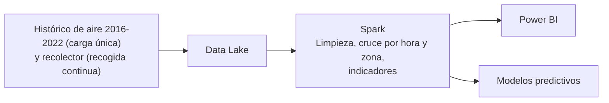
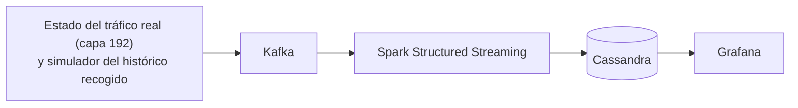
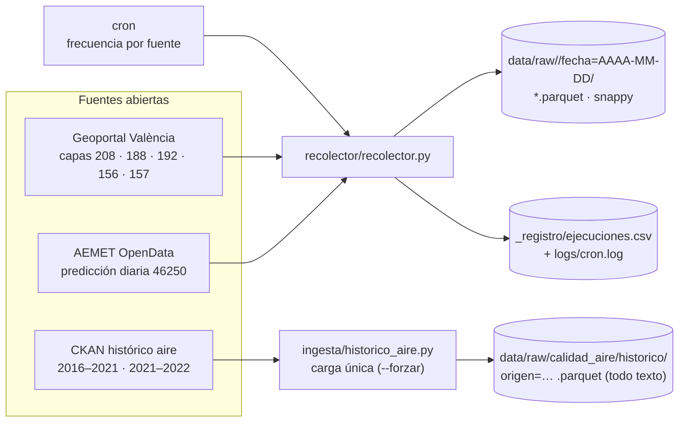
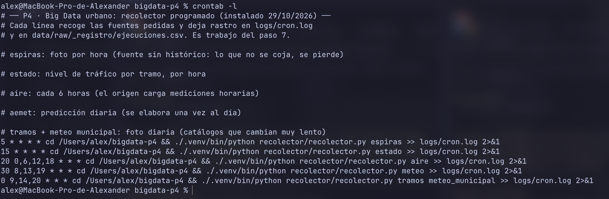
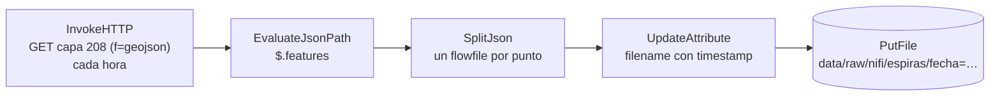
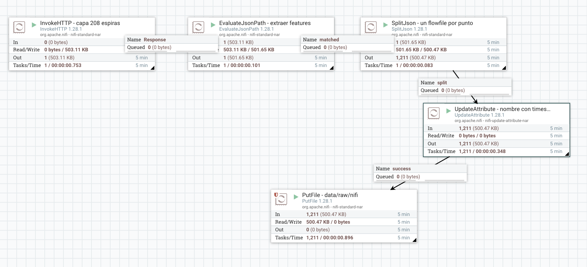

# Proyecto 4 · Big Data urbano (Valencia)

## Descripción y objetivo

Pipeline completo de ingeniería de datos (batch + streaming) sobre datos abiertos de tráfico, calidad del aire y meteorología de Valencia. Los datos se cruzan con Spark y el proyecto termina con dos modelos predictivos: uno principal de NO₂ horario y uno secundario de intensidad de tráfico.

## Estructura del repo

```
bigdata-p4/
├── README.md
├── requirements.txt            # requests, pyarrow, python-dotenv
├── .env.example                # plantilla; .env no se versiona
├── docker-compose.yml          # Apache NiFi (ampliación)
├── recolector/
│   ├── recolector.py           # captura periódica -> Parquet por fecha
│   └── crontab.example.txt     # programación con cron
├── ingesta/
│   └── historico_aire.py       # carga única 2016-2022 (CKAN)
├── nifi/
│   ├── flow.json               # flujo NiFi verificado (exportado)
│   └── setup_nifi.py           # importa, configura y arranca el flujo por la API
├── evidencias/                 # capturas (crontab, flujo NiFi)
├── etl/  dashboard/            # bloques posteriores (vacíos)
└── data/  logs/                # ignorados por Git
```

## Arquitectura
 
### Vía batch
 

 
### Vía streaming
 


## Fuentes de datos

Todas las fuentes se exploraron y verificaron el 29/10/2026, accediendo a las URLs de consulta en vivo.

| Fuente (nombre en el recolector) | Origen | Capa / endpoint | ¿API key? | Frecuencia en origen | Frecuencia de ingesta | ¿Histórico público? |
| --- | --- | --- | --- | --- | --- | --- |
| Tráfico · espiras (`espiras`) | Geoportal Valencia (ArcGIS MapServer) | `Trafico/MapServer/208` (puntos de medida) | No | Cada pocos minutos | Horaria (cron) | No: solo la foto actual |
| Tráfico · tramos (`tramos`) | Geoportal Valencia (ArcGIS MapServer) | `Trafico/MapServer/188` | No | Tiempo real | Diaria, 3 intentos (cron) | No |
| Tráfico · estado (`estado`) | Geoportal Valencia (ArcGIS MapServer) | `Trafico/MapServer/192` | No | Cada 3 min | Horaria (cron) | No |
| Calidad del aire (`aire`) | Geoportal Valencia (ArcGIS MapServer) | `MedioAmbiente/MapServer/156` (estaciones) | No | Horaria | Cada 6 h (cron) | Solo 2016–2022, en el portal CKAN |
| Meteorología (`meteo`) | AEMET OpenData | `prediccion/especifica/municipio/diaria/46250` | Sí (personal, en `.env`) | Diaria | Diaria, 3 intentos (cron) | No: devuelve la predicción de ~7 días |
| Histórico aire 2016–2022 | Portal CKAN (recursos 2016–2021 y 2021–2022) | `datastore_search` | No | Estático | Carga única (`ingesta/historico_aire.py`) | Sí: 449.026 + 201.480 filas |
| *Extra:* estaciones meteo municipales (`meteo_municipal`) | Geoportal Valencia (ArcGIS MapServer) | `MedioAmbiente/MapServer/157` | No | — | Diaria, 3 intentos (cron) | No |

Para cualquier capa del Geoportal, la consulta base es la misma y solo cambia la capa:

```
https://geoportal.valencia.es/server/rest/services/OPENDATA/{capa}/query?where=1=1&outFields=*&f=geojson
```

- `where=1=1`: filtro que siempre se cumple, devuelve todos los registros.
- `outFields=*`: pide todos los campos de atributos.
- `f=geojson`: formato de respuesta; si se omite, ArcGIS devuelve HTML propio.

Truco de exploración: añadiendo `&resultRecordCount=3` se piden solo 3 registros, y la metadefinición de la capa (campos y tipos) se consulta con `.../208?f=pjson`.

### Tráfico — puntos de medida (capa 208)

Cada registro es un **punto de medida** de tráfico en la ciudad (unos 1200 en total, uno por sensor). No guarda histórico: es una foto del estado en el instante de la consulta, y la serie temporal la construirá el propio proyecto acumulando capturas diarias.

Campos que usamos del pipeline:

- `idpm`: identificador del punto de medida.
- `ih`: intensidad horaria, vehículos/hora. `-1` es centinela de sensor sin dato y se filtrará en el ETL.
- `fecha_actualizacion`: última actualización del sensor, en epoch **milisegundos** (se convierte a UTC).
- `geometry.coordinates`: lon/lat del sensor (WGS84), disponible para mapas.

Campos que no usamos: `angulo` (orientación del tramo), `gid`, `globalid`, `created_*`/`last_edited_*` (auditoría interna de ArcGIS) y `fiwareid`, que está vacío en los registros observados.

### Calidad del aire — estaciones (capa 156)

Cada registro es una **estación de medición** (11 en la muestra: Dr. Lluch, Cabanyal, Centro, Viveros…) con la última medición cargada de cada contaminante.

- `nombre`: nombre de la estación.
- `no2`, `pm10`, `pm25`: µg/m³ medidos (los usados son `no2` y `pm10`; no todas las estaciones miden PM, hay nulos que las agregaciones ignorarán).
- `fecha_carg`: momento de carga de la medición, epoch en milisegundos.
- `parametros`, `calidad_am`, `tipozona`, `tipoemisio`: informativos, no los usamos.

### Meteorología — AEMET (predicción diaria)

Consulta en **dos pasos**: la primera llamada al endpoint (con cabecera `api_key`) no devuelve la predicción, sino un JSON con un campo `datos` que contiene una segunda URL temporal; la predicción real llega descargando esa segunda URL.

La respuesta es una lista con un único elemento, con `prediccion.dia[]`: un bloque por día pronosticado (7 en la captura del 29/10). De cada día extraemos:

- `fecha` → fecha del pronóstico.
- `temperatura.maxima` / `temperatura.minima`.
- `probPrecipitacion` con atributo periodo `"00-24"` → probabilidad del día completo (%).

El resto de campos (cielo, viento, humedad…) los ignora el pipeline. La clave API es personal, se solicita en el centro de descargas de AEMET y se guarda en `.env` (nunca en el código ni en Git). Cada ingesta trae varios días, así que las capturas consecutivas se solapan: la deduplicación se hará en el Bloque 4.

## Bitácora de prácticas

### Bloque 1 · Práctica P4 — Ingesta de datos abiertos urbanos

**Estado (12/11/2026):** recolector operativo con las fuentes del Geoportal y AEMET, cron programado y funcionando en local desde el 29/10 (con el repositorio como ubicación definitiva desde el 12/11), e histórico 2016–2022 cargado (650.506 filas).

#### Cómo ejecutar

```bash
cd bigdata-p4                               # raíz del repo
python3 -m venv .venv && source .venv/bin/activate
pip install -r requirements.txt
cp .env.example .env                        # rellenar AEMET_API_KEY

python recolector/recolector.py             # todas las fuentes
python recolector/recolector.py espiras aire # solo las pedidas
python ingesta/historico_aire.py            # carga única (salta si ya existe)
python ingesta/historico_aire.py --forzar   # rehace la carga
```

Se ejecuta siempre desde la raíz del repo (las rutas `data/` y `logs/` son relativas). Fuentes válidas: `espiras`, `tramos`, `estado`, `aire`, `meteo` (predicción de AEMET) y `meteo_municipal` (capa 157 de estaciones meteorológicas del Geoportal, extra no exigido). `aemet` se admite como alias de `meteo`.

El crontab de referencia está en `recolector/crontab.example.txt` (rutas a `/Users/alex/bigdata-p4`; el propio fichero explica cómo instalarlo).

#### Diagrama de la ingesta



#### Programación con cron (justificación fuente a fuente)

La regla: se recoge más seguido aquello cuya foto se pierde para siempre al no capturarla, y se escalonan los minutos entre fuentes para no machacar el portal.

| Fuente | Programa | Justificación |
| --- | --- | --- |
| espiras | `5 * * * *` (cada hora) | Se actualiza cada pocos minutos y **no existe histórico público**: la única serie posible la construye el propio proyecto |
| estado | `15 * * * *` (cada hora) | Nivel de tráfico por tramo renovado cada 3 min; la foto por hora da la granularidad mínima usable |
| aire | `20 0,6,12,18 * * *` (cada 6 h) | El origen carga mediciones horarias; 4 fotos/día no pierde ninguna lectura y evita ficheros redundantes |
| meteo (AEMET) | `30 8,13,19 * * *` (diaria, 3 intentos) | La predicción se elabora una vez al día; se intenta 3 veces para no perderla si el Mac está en reposo (ver nota) |
| tramos + meteo_municipal | `0 9,14,20 * * *` (diaria, 3 intentos) | Catálogos y estaciones municipales, cambian muy lento; mismos 3 intentos |

> **Nota sobre los intentos múltiples.** El cron de macOS solo ejecuta lo que toca mientras el equipo está despierto y no recupera las ejecuciones perdidas. Con una sola ejecución diaria a las 08:30/09:00, el registro mostró días sin captura (AEMET: 1, 3, 8, 10, 11 y 12 de noviembre; tramos: 11 y 12). Por eso las fuentes diarias se lanzan 3 veces al día: si una cae con el Mac dormido, otra suele coger la foto. Las capturas repetidas del mismo día llevan su propio `captura_utc` y el ETL (Bloque 4) las deduplica. Las fuentes horarias (espiras, estado) también tienen huecos cuando el equipo se suspende, lo que se evidencia en `ejecuciones.csv`; en un servidor siempre encendido no ocurriría.

#### Evidencia de automatización (cron)

Resultado real de `data/raw/_registro/ejecuciones.csv` (del 29/10 al 12/11/2026, hora UTC):

| Fuente | Ejecuciones | Fallos |
| --- | ---: | ---: |
| espiras | 173 | 0 |
| estado | 170 | 1 |
| aire | 21 | 1 |
| meteo | 11 | 1 |
| meteo_municipal | 12 | 0 |
| tramos | 11 | 0 |

`meteo` es la predicción de AEMET y `meteo_municipal` las estaciones meteorológicas del Geoportal. Hasta el 12/11 el registro las llamaba `aemet` y `meteo` respectivamente; en la tabla ya están agrupadas bajo los nombres actuales. Los 3 fallos quedaron registrados con su mensaje y no interrumpieron al resto de fuentes.



*Figura. Salida de `crontab -l` con las cinco entradas del recolector.*

#### Ampliación: Apache NiFi

Flujo visual que reproduce la captura de espiras (capa 208) para compararlo con el script Python. Está en `nifi/flow.json` (exportado con "Download flow definition") y se ejecutó con NiFi 1.28.1 en Docker.



**Cómo reproducirlo**

1. Poner `NIFI_PASSWORD` (mínimo 12 caracteres) en `.env` y arrancar: `docker compose up -d`. La interfaz queda en `https://localhost:8443/nifi` (usuario `admin`; el certificado es autofirmado y el navegador avisa).
2. Crear el almacén de confianza del Geoportal (ver nota siguiente) en `data/tmp/trust_geoportal_2026.jks`. `docker-compose.yml` monta `data/` como `/data` en el contenedor.
3. **Automático:** `./.venv/bin/python nifi/setup_nifi.py` importa `nifi/flow.json`, escribe la contraseña del almacén (la lee de `data/tmp/trust_geoportal_2026.pass`), habilita el servicio SSL y arranca el flujo.
4. **Manual (alternativa):** arrastrar un *Process Group* al lienzo y subir `nifi/flow.json`; en el servicio `Confianza Geoportal ACCV` escribir la contraseña del almacén (NiFi no exporta valores sensibles), habilitarlo y arrancar el flujo.

**Incidencia: certificado del Geoportal.** La primera ejecución de `InvokeHTTP` falló con `PKIX path building failed`: el Java de NiFi no incluye la raíz ACCV que firma el certificado del Geoportal. El script Python (con `requests`) no tuvo este problema. Se resolvió importando los tres certificados de la cadena (servidor, `ACCV RSA1 TLS` y `ACCVRAIZ1`) en un almacén JKS y enlazándolo mediante un `StandardSSLContextService`:

```bash
openssl s_client -showcerts -connect geoportal.valencia.es:443 </dev/null   # separar los 3 certificados en geoportal_0.pem, _1.pem y _2.pem
for i in 0 1 2; do
  keytool -importcert -noprompt -alias geoportal_$i -file data/tmp/geoportal_$i.pem \
          -keystore data/tmp/trust_geoportal_2026.jks -storetype JKS -storepass "<contraseña>"
done
```

**Resultado:** una ejecución produjo 1.211 ficheros GeoJSON (un `Feature` por punto de medida), el mismo número de filas que recoge el script Python en una captura.



*Figura. Flujo NiFi tras una ejecución: `SplitJson` genera 1.211 flowfiles (uno por punto de medida) y `PutFile` los escribe todos en `data/raw/nifi/`.*

#### Comparativa Python vs NiFi

| Aspecto | Recolector Python | Flujo NiFi |
| --- | --- | --- |
| Desarrollo | Más trabajo al principio: reintentos, paginación, registro y Parquet se programan a mano (~245 líneas) | Montar los 5 procesadores es rápido, pero la puesta en marcha costó más (certificado del Geoportal, contraseña, importar el flujo) |
| Depurar un fallo | El error queda en `ejecuciones.csv` y en `logs/cron.log`, y se reproduce en local con un comando | El fallo sale en rojo sobre el procesador (el `PKIX` se vio al instante), pero el aviso desaparece y no queda en ningún fichero |
| Ver el estado | Solo después, leyendo logs y el CSV | En tiempo real: contadores, colas y *Data Provenance* en la interfaz |
| Versionado en Git | Texto con diffs legibles | `flow.json` va en una sola línea y no se puede revisar en un diff; además no guarda las contraseñas |
| Recursos | Un proceso de segundos, sin consumo entre ejecuciones | Un contenedor con JVM siempre encendido |
| Errores y reintentos | 3 intentos con espera creciente; el fallo se anota por fuente | `Failure` y `Retry` están terminadas en este flujo: si falla, se pierde esa captura hasta la hora siguiente |
| Datos de salida | 1 Parquet (snappy, con `captura_utc`) por captura: 66 KB | 1.211 JSON pequeños por captura; habría que compactarlos antes de usar Spark |
| Registro de ejecuciones | `ejecuciones.csv` con fuente, filas, éxito y error | No hay equivalente sin añadir más procesadores |

**Conclusión.** Para capturar una API sencilla de forma periódica y guardarla en Parquet, Python es más ligero, más fácil de versionar y escribe directamente el formato que necesita el Data Lake. NiFi compensa cuando hay muchas fuentes y destinos, o cuando importa ver el flujo en tiempo real sin programar. Aquí pesaron en contra los miles de ficheros pequeños y la falta de registro propio, así que el recolector Python es la solución principal y NiFi queda como contraste.

#### Incidencias y hallazgos

- **Registro probado con un fallo real**: el 29/10 una versión del recolector falló al pasar la cabecera a la función compartida; `ejecuciones.csv` lo capturó con su mensaje y las demás fuentes siguieron sin darse por aludidas. Corregido en minutos — y queda en la bitácora, que es de lo que va un registro.
- **Calidad del dato de tráfico (muestra del 29/10)**: 214 de 1.211 registros con `ih = null` y 30 con `ih = -1` (centinela de sensor sin dato). Ambos casos se filtrarán en el ETL del Bloque 4.
- **AEMET**: un timeout del primer intento resuelto por el reintento automático (10 s). Ninguna API es 100 % estable: el recolector no puede confiar y equivale a diseñarlo con reintentos desde el día uno.
- **Clave AEMET**: la del alta anterior (formato JWT) se había extraviado; recuperada del correo de alta y guardada en `.env` con permisos 600. Nunca en código ni Git.
- **Histórico CKAN**: los dos tramos tienen formatos de fecha/hora distintos (fecha ISO con hora incluida vs fecha corta; horas con/sin segundos). Inspección rápida: 0 fechas con mes > 12, así que el posible intercambio día/mes (entre valores válidos) lo caza el ETL mirando la cronología. Los valores se guardan en **texto tal cual**: lo estragado no puede ser mío.
- **Alcance del histórico, verificado en vivo (29/10)**: el datastore del primer recurso va del 2016-01-01 al 2021-12-31 y el del segundo del 2021-01-01 al 2022-12-31. **2021 completo está en ambos**: la suma 650.506 lo cuenta dos veces, y la deduplicación será del Bloque 4. No hay nada posterior publicado (5 datasets de aire en el portal y ninguno supera 2022; uno nuevo de febrero 2026, "2016–2020", es un subconjunto de 352.666 filas de lo ya cargado). Desde 2023 no existe foto pública del aire: la serie actual la construye el recolector desde el 29/10 (capa 156 + cron), tal y como asume el enunciado al fijar el alcance del paso 8 en 2016–2022.
- **Compresión**: 650.506 filas × 28 columnas → 10,8 MB en Parquet (snappy), sin tocar nada.

#### Próximos pasos

- Bloque 3: subir capturas + histórico a la zona raw del Data Lake.
- Bloque 4: ETL que limpie, deduplique y cruce tráfico + aire + meteo por hora.
 